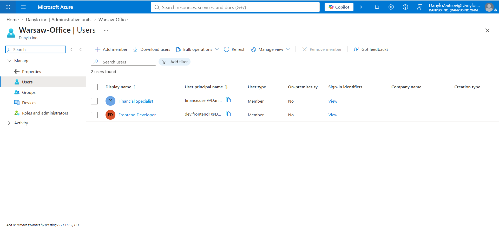
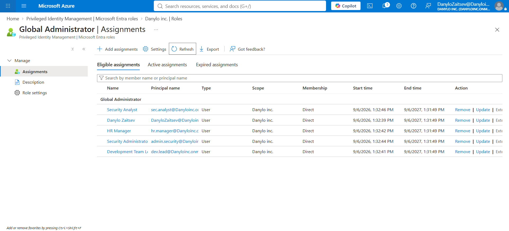
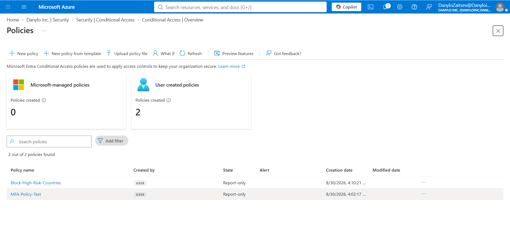

# Enterprise Zero Trust Identity Governance in Microsoft Entra ID

## Executive Summary
This project demonstrates the design and implementation of an enterprise-grade Identity and Access Management (IAM) framework for **Danylo inc.** using Microsoft Entra ID (P2). The solution adheres strictly to **Zero Trust principles** ("Never Trust, Always Verify", Least Privilege, and Assume Breach).

## Implemented Architecture & Security Controls

### 1. Perimeter & Access Control (Conditional Access)
* **Geo-Fencing:** Defined `High-Risk Countries` Named Locations to restrict unauthorized geographic entry points.
* **Access Policies:** Implemented automated Block policies for risky locations and forced Multi-Factor Authentication (MFA) across all standard identity sign-ins.

### 2. Least Privilege & Administrative Scoping
* **Administrative Units (AU):** Created the `Warsaw-Office` AU to segment directory administration.
* **Restricted Scope Delegation:** Scoped `User Administrator` roles specifically to the `Warsaw-Office` AU, ensuring local admins cannot alter identities outside their assigned boundary.

### 3. Privileged Identity Management (PIM)
* **Zero Standing Access (ZSA):** Eradicated permanent administrative assignments in favor of Just-In-Time (JIT) activations.
* **Time-Bound Assignments:** Configured Eligible role assignments requiring MFA verification, business justification, and auto-expiring time limits.

## Verification & Proof of Concept

### 1. Administrative Unit & Restricted Scope

### 2. Privileged Identity Management (PIM)

### 3. Conditional Access Policies

